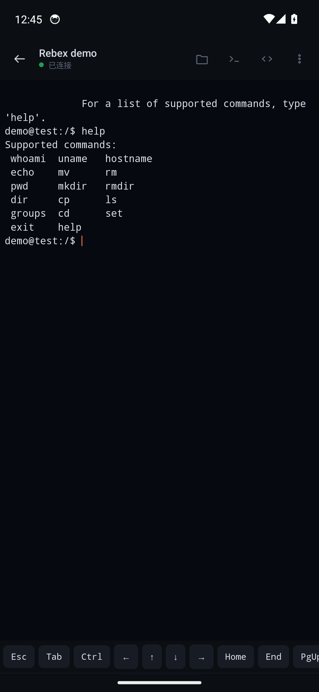
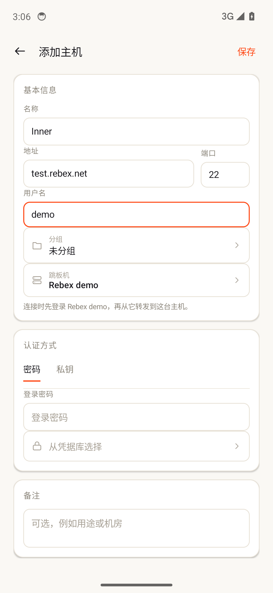
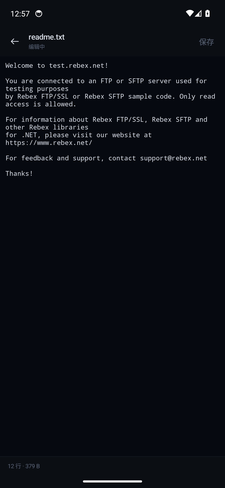

# OneSSH

一个 **Android 原生 SSH 客户端**。纯 Java + Android 原生 View 手写界面，没有 Jetpack Compose、没有 React Native、没有 WebView，唯一的第三方依赖是 JSch（以 jar 形式内置在仓库里）。所有数据只存在本机，不联网上报，不申请任何敏感权限。

- 版本：`2.0.0`（versionCode 2）
- 最低系统：Android 8.0（API 26），targetSdk 34，compileSdk 36
- 权限：`INTERNET` / `ACCESS_NETWORK_STATE` / `VIBRATE`

## 截图

| 主机列表 | 终端 | 跳板机设置 |
|---|---|---|
|  |  |  |

| 文件管理 | 远程文件编辑 | 凭据库 |
|---|---|---|
|  |  |  |

更多截图见 [`screenshots/`](screenshots/)：`groups.png`、`snippets.png`、`settings.png`、`editor.png`、`group-pick.png`。

## 功能

**主机与连接**
- 主机列表按分组折叠、可搜索名称／地址／备注，支持临时直连（不保存）
- 认证方式：密码、私钥（OpenSSH / RSA / ECDSA PEM，支持带口令私钥）、`keyboard-interactive`
- **跳板机（ProxyJump，单跳）**：在主机表单里选另一台已保存的主机当跳板，终端、SFTP、远程编辑全部走同一条链路
- 首次连接弹主机密钥指纹确认；指纹变化会强警告并可中断连接，已信任指纹在「设置」里可查看／清空

**终端**
- 自绘终端视图：ANSI 颜色与属性、滚动缓冲、可调节字号、复制全部、清屏
- 常用按键条、命令片段库、可设置终端页保持常亮

**文件（SFTP）**
- 目录浏览、上传、下载、新建文件夹、重命名、删除
- 内置文本编辑器可直接打开远程文件并保存回服务器

**安全**
- 密码和私钥内容用 **Android Keystore** 生成的 AES-256-GCM 密钥加密后落盘，密钥不出系统进程；`allowBackup=false`
- 设置里可一键清空所有主机、分组、凭据、私钥和已信任指纹

## 跳板机是怎么工作的

`SshSession` 会先单独建立一条到跳板机的 SSH 连接（独立的密钥身份与独立的 known_hosts 记录），然后按以下顺序为「手机 → 目标主机」准备隧道：

1. **`direct-tcpip`（标准 ProxyJump）**：预检开一个转发通道再关掉，能用就用，性能最好
2. **自动降级到命令隧道**：如果 sshd 设了 `AllowTcpForwarding no`，就在跳板机上开一个 `exec` 通道跑 `nc <目标> <端口>`（依次尝试 `nc` / `ncat` / `socat`），把这条命令的 stdin/stdout 当作 TCP 隧道。这条路不依赖 sshd 的转发开关，Alpine 的 busybox 自带 `nc`，一般直接命中
3. **都没有才报错**，并区分「跳板机没装管道工具」（提示 `apk add netcat-openbsd`）与「跳板机连不到目标」（提示在跳板机上跑 `nc -vz` 排查）

> 限制：只支持单跳（A → 跳板 → 目标）。命令隧道要求跳板机账号能执行 shell 命令；如果 sshd 配了 `ForceCommand` 或账号是受限 shell（`rbash`），只能把 `AllowTcpForwarding` 打开。

## 构建

### 🌐 在 GitHub 上直接编译（零配置）

仓库自带完整的 Gradle Wrapper（含 `gradle/wrapper/gradle-wrapper.jar`）和唯一的第三方依赖 `app/libs/jsch-2.28.8.jar`：没有 `local.properties`、没有私有 Maven 源、不需要任何 Secrets 或签名密钥。推到 GitHub 后 [`.github/workflows/build.yml`](.github/workflows/build.yml) 会自动开跑。

| 触发方式 | 结果 |
|---|---|
| `push` 到 `main` / `master`、提交 PR | 编译 Debug + Release，Actions 页面提供 APK 下载（保留 30 天） |
| 推送 `v*` 标签（如 `v2.0.0`） | 在上面基础上自动创建 GitHub Release，附上两个 APK |
| Actions 页手动 `Run workflow` | 随时补一次构建；勾选「同时创建 GitHub Release」可不打标签直接发版 |

CI 环境：`ubuntu-latest` + Temurin JDK 21，自动安装 `platforms;android-36`、`build-tools;36.0.0`、`platform-tools`，Gradle 发行版与依赖带缓存。产物在 **Actions → 对应 run → Artifacts** 下载，名字带版本号（如 `OneSSH-2.0.0-debug`），其中 Debug 可直接安装、Release 需先签名（见下）。

> ℹ️ 普通 `push` / PR 时，「发布 Release」这个 job 会显示 **skipped**，这是正常的 —— 它只在推送 `v*` 标签、或手动运行并勾选发版时执行。APK 不受影响，到 **Actions → 对应 run → Summary 底部 Artifacts** 下载即可（保留 30 天）。

> ⚠️ 不要再加 `android-actions/setup-android@v3`：它默认安装已被 Google 下架的 legacy `tools` 包，会在 SDK 准备阶段报 `Failed to find package 'tools'` 并以退出码 1 失败。本流水线直接定位 runner 预装的 SDK 与 `sdkmanager`，不依赖该 action。

首次上传（如尚未建仓）：

```bash
git init
git add .
git update-index --chmod=+x gradlew   # 保证 Linux runner 上可执行
git commit -m "Initial commit: OneSSH 2.0.0"
git remote add origin git@github.com:<OWNER>/<REPO>.git
git push -u origin main
```

> Fork 后同样零配置，只需在 fork 仓库的 Actions 页面启用 workflows。流水线不写死账号、包名或路径，改仓库名不影响构建。

### 🏷️ 只改版本号就能编译发版

版本号只有一个来源：`app/build.gradle.kts` 里的 `versionCode` / `versionName`（当前 `2` / `2.0.0`）。CI 每次构建都会读取它，把 APK 归档为 `OneSSH-<版本>-debug.apk` 与 `OneSSH-<版本>-release-unsigned.apk`，上传的 Artifact 与 GitHub Release 附件也都带这个版本号；打标签时若 `v*` 与 `versionName` 不一致，日志里会给出警告。

```bash
# 1) 改 app/build.gradle.kts 里的 versionCode / versionName
#    （顺手同步本文件顶部的「版本」一行）
# 2) 提交推送 —— 自动编译
git add app/build.gradle.kts README.md && git commit -m "chore: bump version to 2.0.1" && git push

# 3) 打同名标签 —— 自动创建 GitHub Release 并附上带版本号的 APK
git tag v2.0.1 && git push origin v2.0.1
```

> **不是只有改版本号才编译**：任何 `push` 到 `main` / `master`、任何 PR、以及手动 `Run workflow` 都会编译，改版本号只是最普通的一次 push。
>
> **只在网页上操作、不方便打标签？** 打开 **Actions → Android CI → Run workflow**，勾选「同时创建 GitHub Release」再运行：流水线会按当前 `versionName` 自动创建 `v<版本>` 标签与 Release，并附上两个带版本号的 APK，全程不用本地 git。

### 💻 本地构建

环境要求：

| 组件 | 版本 |
|---|---|
| JDK | 17+（CI 与实测均用 Temurin / JBR 21） |
| Android SDK | platform `android-36`、build-tools `36.0.0`（AGP 9.1.0 默认） |
| Gradle | 9.3.1（已配好 wrapper，无需本机预装） |
| Android Gradle Plugin | 9.1.0 |

```bash
# 首次构建需联网下载 Gradle 发行版与 AGP；之后可加 --offline
./gradlew assembleDebug      # app/build/outputs/apk/debug/app-debug.apk                约 1.2 MB
./gradlew assembleRelease    # app/build/outputs/apk/release/app-release-unsigned.apk  约 1.0 MB
```

用 Android Studio 打开根目录即可，`local.properties` 会自动生成（**不要提交**，里面是本机 SDK 绝对路径）。JSch 的 jar 已在 `app/libs/`，`settings.gradle.kts` 只配了 google() / mavenCentral()，构建不会去拉额外运行时依赖。

> ✅ 已实测：JDK 21.0.9 + Android SDK 36 / build-tools 36.0.0 下 `assembleDebug assembleRelease` 一次通过（73 个 task、约 40 秒），产物为 `com.onessh.app` 2.0.0（minSdk 26 / targetSdk 34）。

### 签名 Release

仓库**不含签名密钥库**（`keystore/` 已被 `.gitignore` 排除），请自己生成并保管：

```bash
keytool -genkeypair -v -keystore keystore/onessh-release.jks \
  -alias onessh-release -keyalg RSA -keysize 2048 -validity 10000

$ANDROID_HOME/build-tools/36.0.0/zipalign -p -f 4 \
  app/build/outputs/apk/release/app-release-unsigned.apk /tmp/aligned.apk
$ANDROID_HOME/build-tools/36.0.0/apksigner sign \
  --ks keystore/onessh-release.jks --out OneSSH-2.0.0.apk /tmp/aligned.apk
$ANDROID_HOME/build-tools/36.0.0/apksigner verify OneSSH-2.0.0.apk
```

也可以直接在 `app/build.gradle.kts` 里配 `signingConfigs`，用环境变量读密码，避免写死在脚本里。

> CI 默认**只产出未签名 Release APK**（仓库不含 keystore，`.gitignore` 也排除了 `*.jks` / `keystore/`）。若想让 GitHub Actions 直接出签名包：把 keystore 以 base64 存进仓库 Secrets（如 `SIGNING_KEYSTORE_BASE64`、`KEYSTORE_PASSWORD`、`KEY_ALIAS`、`KEY_PASSWORD`），在 workflow 中解码到 `keystore/onessh-release.jks`，再于 `app/build.gradle.kts` 用 `System.getenv()` 读取并配置 `signingConfigs`。调试和自用请优先下载 `OneSSH-debug`，它带 debug 签名，可直接安装。

## 目录结构

```
app/src/main/java/com/onessh/app/
├── *.Activity           界面：主页 / 主机表单 / 终端 / 文件 / 编辑 / 分组 / 片段 / 凭据 / 设置
├── data/                Host、Credential、KeyItem、Snippet、Store（JSON 落盘）、Crypto（Keystore 加密）
├── ssh/                 SshSession（连接、跳板、SFTP）、KnownHosts、HostKeyPrompt
├── term/                TerminalView、TerminalBuffer、AnsiParser、TermColors（自绘终端）
└── ui/                  UI、Widgets、Dialogs、Icons、SvgPath（纯代码绘制的控件与图标）
app/libs/jsch-2.28.8.jar 唯一第三方依赖
```

根目录另有 `.github/workflows/build.yml`（GitHub Actions 流水线）与 `.gitattributes`（固定 `gradlew` 用 LF 行尾、二进制文件不做换行转换）。

## 依赖与许可

- [JSch 2.28.8](http://www.jcraft.com/jsch/) —— SSH2 实现，以 jar 形式随仓库分发，遵循其原有 BSD 风格许可
- 本项目尚未指定许可证，上传到 GitHub 时请自行选择（MIT / Apache-2.0 / GPL-3.0 等）并添加 `LICENSE` 文件；随仓库分发的 JSch jar 建议在 `app/libs/` 附一份其原始许可文本

## 说明

- 主机、密码、私钥、指纹全部只保存在应用私有目录，卸载即清除；没有云同步，也没有账号体系
- CI 由 `.github/workflows/build.yml` 提供（编译 → 上传 APK → 打标签发版）；项目目前仍不含单元测试，后续可补 `app/src/test/`
