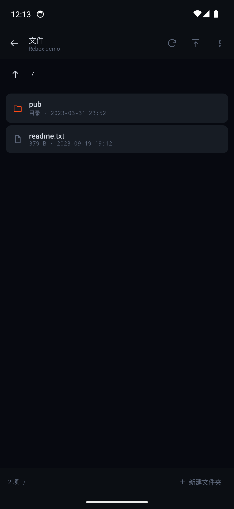
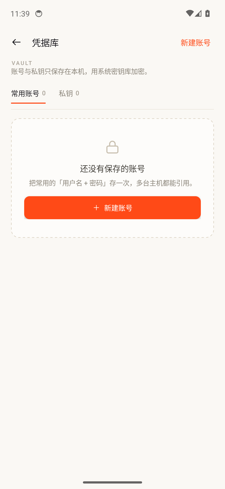

# OneSSH

一个 **Android 原生 SSH 客户端**。纯 Java + Android 原生 View 手写界面，没有 Jetpack Compose、没有 React Native、没有 WebView，唯一的第三方依赖是 JSch（以 jar 形式内置在仓库里）。所有数据只存在本机，不联网上报，不申请任何敏感权限。

- 版本：`2.0.0`（versionCode 2）
- 最低系统：Android 8.0（API 26），targetSdk 34，compileSdk 36
- 权限：`INTERNET` / `ACCESS_NETWORK_STATE` / `VIBRATE`

## 截图

| 主机列表 | 终端 | 跳板机设置 |
|---|---|---|
|  |  |  |

| 文件管理 | 远程文件编辑 | 凭据库 |
|---|---|---|
|  |  |  |

更多截图见 [`screenshots/`](screenshots/)：`groups.png`、`snippets.png`、`settings.png`、`editor.png`、`group-pick.png`。

## 功能

**主机与连接**
- 主机列表按分组折叠、可搜索名称／地址／备注，支持临时直连（不保存）
- 认证方式：密码、私钥（OpenSSH / RSA / ECDSA PEM，支持带口令私钥）、`keyboard-interactive`
- **跳板机（ProxyJump，单跳）**：在主机表单里选另一台已保存的主机当跳板，终端、SFTP、远程编辑全部走同一条链路
- 首次连接弹主机密钥指纹确认；指纹变化会强警告并可中断连接，已信任指纹在「设置」里可查看／清空

**终端**
- 自绘终端视图：ANSI 颜色与属性、滚动缓冲、可调节字号、复制全部、清屏
- 常用按键条、命令片段库、可设置终端页保持常亮

**文件（SFTP）**
- 目录浏览、上传、下载、新建文件夹、重命名、删除
- 内置文本编辑器可直接打开远程文件并保存回服务器

**安全**
- 密码和私钥内容用 **Android Keystore** 生成的 AES-256-GCM 密钥加密后落盘，密钥不出系统进程；`allowBackup=false`
- 设置里可一键清空所有主机、分组、凭据、私钥和已信任指纹

## 跳板机是怎么工作的

`SshSession` 会先单独建立一条到跳板机的 SSH 连接（独立的密钥身份与独立的 known_hosts 记录），然后按以下顺序为「手机 → 目标主机」准备隧道：

1. **`direct-tcpip`（标准 ProxyJump）**：预检开一个转发通道再关掉，能用就用，性能最好
2. **自动降级到命令隧道**：如果 sshd 设了 `AllowTcpForwarding no`，就在跳板机上开一个 `exec` 通道跑 `nc <目标> <端口>`（依次尝试 `nc` / `ncat` / `socat`），把这条命令的 stdin/stdout 当作 TCP 隧道。这条路不依赖 sshd 的转发开关，Alpine 的 busybox 自带 `nc`，一般直接命中
3. **都没有才报错**，并区分「跳板机没装管道工具」（提示 `apk add netcat-openbsd`）与「跳板机连不到目标」（提示在跳板机上跑 `nc -vz` 排查）

> 限制：只支持单跳（A → 跳板 → 目标）。命令隧道要求跳板机账号能执行 shell 命令；如果 sshd 配了 `ForceCommand` 或账号是受限 shell（`rbash`），只能把 `AllowTcpForwarding` 打开。

## 构建

环境要求：

| 组件 | 版本 |
|---|---|
| JDK | 17+（实测 JDK 21） |
| Android SDK | platform `android-36`、build-tools `36.x`／`37.x` |
| Gradle | 9.3.1（已配好 wrapper，无需本机预装） |
| Android Gradle Plugin | 9.1.0 |

```bash
# 首次构建需联网下载 Gradle 发行版与 AGP；之后可加 --offline
./gradlew assembleDebug      # app/build/outputs/apk/debug/app-debug.apk
./gradlew assembleRelease    # app/build/outputs/apk/release/app-release-unsigned.apk
```

用 Android Studio 打开根目录即可，`local.properties` 会自动生成（**不要提交**，里面是本机 SDK 绝对路径）。JSch 的 jar 已在 `app/libs/`，`settings.gradle.kts` 只配了 google() / mavenCentral()，构建不会去拉额外运行时依赖。

### 签名 Release

仓库**不含签名密钥库**（`keystore/` 已被 `.gitignore` 排除），请自己生成并保管：

```bash
keytool -genkeypair -v -keystore keystore/onessh-release.jks \
  -alias onessh-release -keyalg RSA -keysize 2048 -validity 10000

$ANDROID_HOME/build-tools/37.0.0/zipalign -p -f 4 \
  app/build/outputs/apk/release/app-release-unsigned.apk /tmp/aligned.apk
$ANDROID_HOME/build-tools/37.0.0/apksigner sign \
  --ks keystore/onessh-release.jks --out OneSSH-2.0.0.apk /tmp/aligned.apk
$ANDROID_HOME/build-tools/37.0.0/apksigner verify OneSSH-2.0.0.apk
```

也可以直接在 `app/build.gradle.kts` 里配 `signingConfigs`，用环境变量读密码，避免写死在脚本里。

## 目录结构

```
app/src/main/java/com/onessh/app/
├── *.Activity           界面：主页 / 主机表单 / 终端 / 文件 / 编辑 / 分组 / 片段 / 凭据 / 设置
├── data/                Host、Credential、KeyItem、Snippet、Store（JSON 落盘）、Crypto（Keystore 加密）
├── ssh/                 SshSession（连接、跳板、SFTP）、KnownHosts、HostKeyPrompt
├── term/                TerminalView、TerminalBuffer、AnsiParser、TermColors（自绘终端）
└── ui/                  UI、Widgets、Dialogs、Icons、SvgPath（纯代码绘制的控件与图标）
app/libs/jsch-2.28.8.jar 唯一第三方依赖
```

## 依赖与许可

- [JSch 2.28.8](http://www.jcraft.com/jsch/) —— SSH2 实现，以 jar 形式随仓库分发，遵循其原有 BSD 风格许可
- 本项目尚未指定许可证，上传到 GitHub 时请自行选择（MIT / Apache-2.0 / GPL-3.0 等）并添加 `LICENSE` 文件

## 说明

- 主机、密码、私钥、指纹全部只保存在应用私有目录，卸载即清除；没有云同步，也没有账号体系
- 项目不含单元测试与 CI 配置，后续可自行补 `app/src/test/` 与 GitHub Actions
