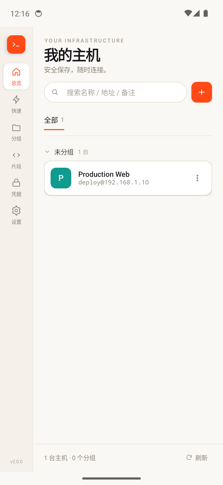
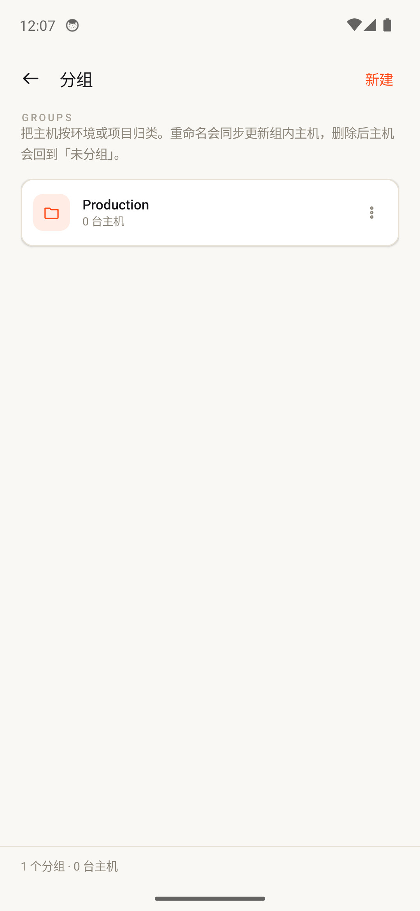
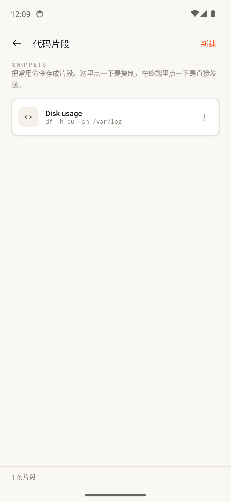
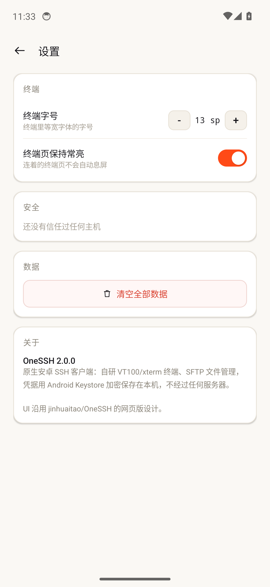
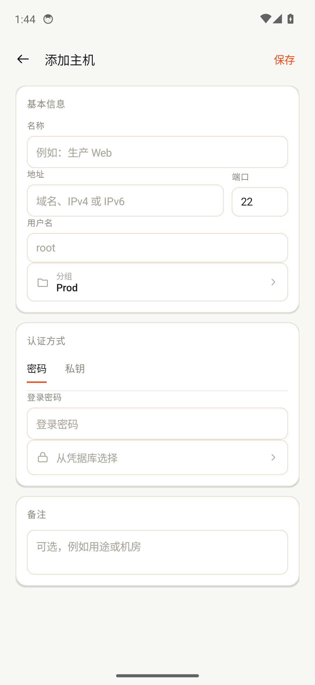
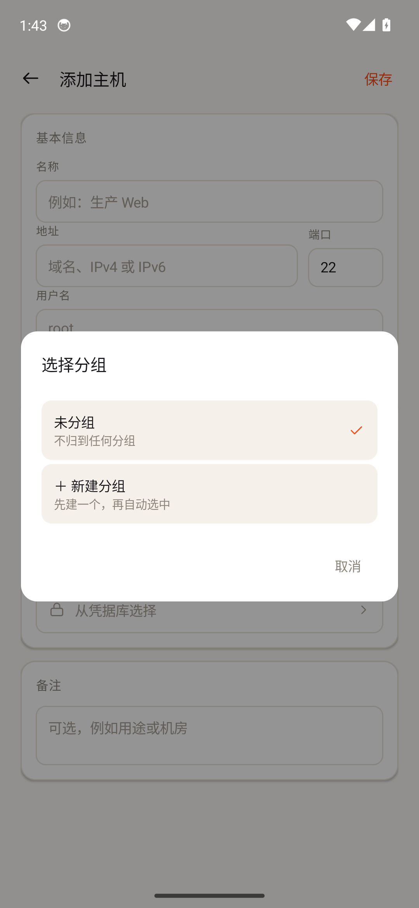

<div align="center">

# 🛰️ OneSSH

**纯原生 Android SSH 客户端**

自绘终端 · 多跳 ProxyJump · SFTP · 零云端依赖


> 纯 Java + 原生 View 手写界面：没有 Compose、没有 RN、没有 WebView。数据只留本机，不联网上报。

</div>

---

## ✨ 能力

| 🔐 连接 | 🖥️ 终端 | 📁 文件 |
|:---|:---|:---|
| 密码 / 私钥 / `keyboard-interactive`<br>分组折叠、搜索、临时直连 | 自绘 ANSI 终端、滚动缓冲<br>字号调节、复制全部、清屏 | SFTP 目录浏览、上传、下载<br>新建 / 重命名 / 删除 |
| 多跳 ProxyJump（最多 5 跳），终端 / SFTP / 编辑同链路<br>主机指纹确认与变更强警告 | 常用按键条、命令片段库<br>终端页保持常亮 | 内置编辑器打开远程文件<br>修改后直接保存回服务器 |

> 🔒 **安全**：凭据经 Android Keystore 的 AES-256-GCM 加密落盘 · `allowBackup=false` · 一键清空全部数据 · 卸载即清除
>
> 🧩 **工程**：minSdk 26 · targetSdk 35 · compileSdk 36 · 仅 `INTERNET` / `ACCESS_NETWORK_STATE` / `VIBRATE` 三项普通权限 · 无账号、无云同步

## 📱 界面

<p align="center">
  
  
  
</p>

<details>
<summary>查看其余 8 张截图</summary>

| 跳板机 | 远程编辑 | 凭据库 |
|:---:|:---:|:---:|
|  |  |  |

| 分组 | 命令片段 | 设置 | 编辑器 | 分组选择 |
|:---:|:---:|:---:|:---:|:---:|
|  |  |  |  |  |

</details>

## 🔀 跳板机链路

> 📱 手机 ──SSH──▶ 🛰️ 跳板机 1 ──隧道──▶ 🛰️ 跳板机 2 ──隧道──▶ 🎯 目标主机　·　多跳（最多 5 跳）

| 顺序 | 通道 | 何时使用 |
|:---:|:---|:---|
| 1️⃣ | `direct-tcpip` | 默认，标准 ProxyJump，先预检再复用，性能最好 |
| 2️⃣ | `nc` / `ncat` / `socat` 命令隧道 | sshd 设了 `AllowTcpForwarding no` 时自动降级，用 `exec` 通道的 stdin/stdout 承载 TCP |
| 3️⃣ | ❌ 明确报错 | 两条都不通，并区分「跳板机缺管道工具」与「连不到目标」 |

> 链路：按主机表单里跳板机链的顺序逐级转发，每一级都先试 `direct-tcpip`，不通再试 `nc` / `ncat` / `socat` 命令隧道；任一级失败都会明确报出是哪一级连不上。
>
> 限制：最多 5 级跳板机，超过会拒绝连接并提示检查链路（防环路）；命令隧道要求跳板机账号能执行 shell，`ForceCommand` / `rbash` 环境只能打开 `AllowTcpForwarding`。

## 🚀 构建

### GitHub Actions · 零配置

推到 GitHub 即自动编译，**任何 push 都会自动发布 Release**（PR 只编译）。

| 触发 | 编译 | Artifact | GitHub Release |
|:---|:---:|:---:|:---|
| `push` 到 `main` / `master` | ✅ | ✅ | ✅ 自动创建/更新 `v<versionName>` |
| 推送 `v*` 标签 | ✅ | ✅ | ✅ 以标签名发布 |
| 手动 `Run workflow` | ✅ | ✅ | ✅ |
| Pull Request | ✅ | ✅ | — |

产物：`OneSSH-2.2.0-debug.apk`（可直接安装）、`OneSSH-2.2.0-release.apk`（配好签名 Secrets 后为已签名包，未配则为 unsigned 包，见下文签名一节）。在 **Actions → 对应 run → Artifacts** 下载，保留 30 天。

> 🔑 CI 使用仓库内固定的 debug 密钥签名，**每次构建的 debug 包签名一致，可直接覆盖安装**。若手机提示「软件包冲突 / 开发者签名异常」，说明旧版是另一把密钥签的：先卸载旧版再安装（会清空应用数据），之后升级就不会再冲突。

**版本号只改一处**：`app/build.gradle.kts` 的 `versionCode` / `versionName`（当前 `4` / `2.2.0`）。改了就出新版本 Release，不改就更新现有 Release 里的 APK；不用打标签、不用勾选开关。

### 本地

```bash
./gradlew assembleDebug     # → app/build/outputs/apk/debug/app-debug.apk            约 1.2 MB
./gradlew assembleRelease   # → app/build/outputs/apk/release/app-release-unsigned.apk  约 1.0 MB
```

JDK 17+（实测 21）· Android SDK 36 + build-tools `36.0.0` · Gradle 9.3.1 / AGP 9.1.0 由 wrapper 固定，无需预装。首次构建需联网，之后可加 `--offline`。

### 本地单元测试

```bash
./gradlew testDebugUnitTest   # 只跑纯 Java 的 term / ssh 纯函数测试，不需要真机、模拟器或 SSH 服务器
```

测试在 `app/src/test/java/com/onessh/app/`：`AnsiParserTest`（转义序列、光标、SGR、DSR 应答）、`TerminalBufferTest`（宽字符、换行、回滚、备用屏、擦除）、`SshSessionTest`（指纹 `SHA256:`、主机端口格式化）、`JumpChainTest`（跳板链解析 / 上移下移 / 满 5 跳拒绝）、`BackupTest`（备份包一层标记、字符串里的花括号）、`ReconnectPolicyTest`（3s / 6s / 12s 退避、最多 3 次）。CI 每次构建都会先跑 `./gradlew testDebugUnitTest`，测试失败就停住，不再编译 APK。

## 🔒 应用锁 · 💾 备份 · 🔁 自动重连（2.2.0）

- **应用锁**：设置 → 安全 → 打开「应用锁」，下次打开 App 要先过系统锁屏（密码 / 图案 / 指纹）验证；没设锁屏时直接放行，不会把人锁在门外。验证只在进程内记一次，杀进程后要重新验证。
- **备份 / 导入**：设置 → 数据 → 「导出备份」存成 `onessh-backup.json`，「导入备份」会整体替换当前数据，导入前会先弹窗确认。备份里的密码 / 私钥仍是本机 Keystore 密文，换设备后要重填，主机、分组、片段、已信任指纹不受影响。
- **自动重连 + 前台服务**：终端意外断开时自动重试最多 3 次（3s / 6s / 12s），手动断开、点了返回、试满 3 次就不再重试；连上之后跑一个低优先级前台服务并显示通知，降低切后台 / 锁屏后被系统回收的概率。会话本身仍归终端页所有，页面销毁后会话还是会关。

<details>
<summary><b>🔧 进阶 · 首次上传 / 签名 Release / 目录结构 / CI 备注</b></summary>

**首次上传**

```bash
git init && git add . && git update-index --chmod=+x gradlew
git commit -m "Initial commit: OneSSH 2.2.0"
git remote add origin git@github.com:<OWNER>/<REPO>.git && git push -u origin main
```

> 用 `git add .`，不要用 `git add *` —— 后者会漏掉 `.gitignore` / `.gitattributes` / `.github/`。`local.properties` 由 Android Studio 自动生成，**不要提交**。Fork 后同样零配置，只需在 Actions 页面启用 workflows。

**签名 Release**

仓库不含 keystore（`*.jks` / `keystore/` 已被 `.gitignore` 排除）：

```bash
keytool -genkeypair -v -keystore keystore/onessh-release.jks -alias onessh-release -keyalg RSA -keysize 2048 -validity 10000
$ANDROID_HOME/build-tools/36.0.0/zipalign -p -f 4 app/build/outputs/apk/release/app-release-unsigned.apk /tmp/aligned.apk
$ANDROID_HOME/build-tools/36.0.0/apksigner sign --ks keystore/onessh-release.jks --out OneSSH-2.2.0.apk /tmp/aligned.apk
$ANDROID_HOME/build-tools/36.0.0/apksigner verify OneSSH-2.2.0.apk
```

CI 直接出签名包（已接通）：把 keystore 以 base64 存进仓库 Secrets `ONESSH_KEYSTORE_BASE64`，并配 `ONESSH_KEYSTORE_PASSWORD` / `ONESSH_KEY_ALIAS` / `ONESSH_KEY_PASSWORD`，`app/build.gradle.kts` 会用 `System.getenv()` 配 `signingConfigs.release`；没配 Secrets 时 Release 仍按 unsigned 构建，不会让构建失败。自用直接装 debug 包即可。

**目录结构**

```
app/src/main/java/com/onessh/app/
├── *.Activity   界面：主页 / 主机表单 / 终端 / 文件 / 编辑 / 分组 / 片段 / 凭据 / 设置
├── data/        Store（JSON 落盘）、Crypto（Keystore 加密）
├── ssh/         SshSession（连接、跳板、SFTP）、KnownHosts、HostKeyPrompt
├── term/        TerminalView、TerminalBuffer、AnsiParser、TermColors
└── ui/          纯代码绘制的控件与图标
app/libs/jsch-2.28.8.jar   唯一第三方依赖
.github/workflows/build.yml  CI 流水线
```

**CI 备注**

- `ubuntu-latest` + Temurin JDK 21，自动安装 `platforms;android-36` / `build-tools;36.0.0` / `platform-tools`，Gradle 带缓存。
- ⚠️ 不要加回 `android-actions/setup-android@v3`：它默认安装已下架的 `tools` 包，会报 `Failed to find package 'tools'` 并退出 1。流水线直接定位 runner 预装的 `sdkmanager`。
- 🔑 `app/debug.keystore.base64` 是 CI 固定 debug 签名，证书 SHA-256 `7D:79:52:39:C2:B3:9B:F3:56:C7:0B:C4:D5:13:A7:9F:7F:E8:1E:BE:D8:51:DD:5E:81:85:93:7E:F8:D0:95:0D`（**仅调试用，切勿用于正式发布**）。
- ✅ 实测：JDK 21.0.9 + SDK 36，`assembleDebug assembleRelease` 一次通过（73 tasks，约 40 秒）。
- 只有 PR 里 `发布 Release` 会显示 skipped，属正常。

</details>

---

## 📄 依赖与许可

本项目以 **GNU General Public License v3.0（GPL-3.0）** 开源，见根目录 `LICENSE`。

[JSch 2.28.8](http://www.jcraft.com/jsch/) · SSH2 实现，jar 随仓库分发（`app/libs/jsch-2.28.8.jar`），遵循其原有 BSD 风格许可，说明见 `app/libs/README-JSch.md`。

<div align="center">

**OneSSH 2.2.0** · 数据只在本机 · 无账号 · 无云同步 · 本地单元测试：`term` 包（AnsiParser / TerminalBuffer）+ `SshSession` 纯函数

</div>
